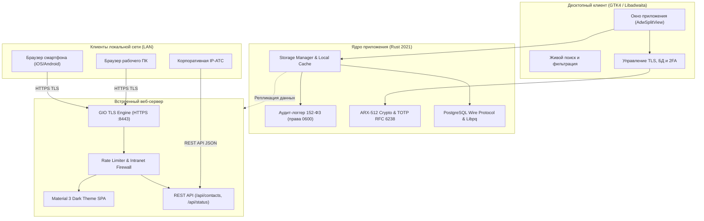

# Corporate Contacts (Корпоративный телефонный справочник)

[](https://www.rust-lang.org/)
[](https://gnome.pages.gitlab.gnome.org/libadwaita/)
[](#безопасность-и-соответствие-152-фз)
[](#встроенный-веб-сервер-и-мобильный-интерфейс)
[](#тестирование)
[](#быстрый-старт)


**Corporate Contacts** — защищённая корпоративная адресная книга и телефонный справочник сотрудников. Приложение сочетает нативный десктопный клиент на **Rust / GTK4 / Libadwaita**, встроенный защищённый веб-сервер **HTTPS (TLS 1.2/1.3)** с интерфейсом в стиле **Google Material 3 Dark Theme**, прямую синхронизацию с **PostgreSQL** по нативному Wire-протоколу и полный комплекс технических мер защиты по **152-ФЗ «О персональных данных»** (Приказ ФСТЭК № 21).


---

## 🌟 Ключевые возможности

### 1. Десктопный клиент (Linux / GNOME)
- **Мгновенный живой поиск**: фильтрация списка сотрудников в реальном времени по ФИО, должности, отделу, филиалу, внутреннему и мобильному номерам, кабинету и этажу.
- **Иерархические фильтры**: удобные выпадающие селекторы локаций/филиалов и подразделений с автоматическим пересчетом количества отображаемых записей.
- **Мягкое скрытие (Soft Delete)**: скрытие уволенных или временных сотрудников из публичного веб-доступа без физического удаления записи в БД с возможностью восстановления.
- **Импорт и экспорт CSV**: адаптивный мастер сопоставления колонок (Field Mapping) с поддержкой русских и английских синонимов (`ФИО`, `Full Name`, `Кабинет`, `Комната`, `Office` и др.).
- **Двухфакторная аутентификация (2FA)**: встроенный генератор TOTP (RFC 6238) с нативной генерацией QR-кода в SVG для Google Authenticator и Яндекс Ключ без внешних облачных сервисов.

### 2. Встроенный веб-сервер и мобильный интерфейс (Material 3 Dark Theme)
- **Автономный Single Page Application**: веб-интерфейс компилируется прямо в исполняемый файл приложения и работает в полностью закрытой локальной сети без внешних CDN.
- **Стиль Google Material You**: пастельная палитра Dark Theme, Tonal Elevation поверхностей, овальный поисковый бар (Search Bar Pill) и компактные бейджи локаций.
- **Интерактивные чипсы вызова**: быстрый набор номера в один клик (`tel:`), открытие почтового клиента (`mailto:`) или копирование реквизитов с всплывающим уведомлением (Toast).
- **REST API**: быстрые JSON-эндпоинты `/api/contacts` и `/api/status` для интеграции с IP-АТС (Asterisk, FreePBX).

---

## 🛡️ Безопасность и соответствие 152-ФЗ

Система спроектирована с учетом требований законодательства РФ о защите персональных данных:

| Мера защиты | Реализация в приложении | Норматив |
|---|---|---|
| **Шифрование канала связи** | Встроенный **HTTPS (TLS 1.2/1.3)** на порту 8443 (GIO TLS) с автоматической генерацией 2048-битного RSA сертификата через OpenSSL. | Ст. 19 152-ФЗ, Приказ ФСТЭК № 21 |
| **Сетевой контур** | Проверка входящих IP: доступ разрешен только для доверенных адресов интранета (RFC 1918 / Loopback). Внешние запросы блокируются с кодом 403. | Защита периметра ИСПДн |
| **Защита от скрейпинга** | Встроенный Rate Limiter (до 150 запросов в минуту на IP) для предотвращения автоматической выгрузки телефонной книги ботами. | Ст. 19 (предотвращение угроз) |
| **Маскирование личных номеров** | Личные мобильные телефоны скрыты маской `+7 999 •••-••-67` и раскрываются только по явному клику «Показать (152-ФЗ)». | Ст. 7 152-ФЗ (Конфиденциальность) |
| **Автоблокировка экрана** | При неактивности пользователя более 10 минут веб-экран блокируется оверлеем для защиты от несанкционированного просмотра коллегами. | Режим чистых экранов |
| **Журнал аудита доступа** | Протоколирование всех событий (входы, отказы в авторизации, изменение статусов) в `/var/log/corporate-contacts/audit.log` с правами `0600`. | Ст. 19 (контроль фактов доступа) |
| **Шифрование настроек** | Пароли к БД и секретные ключи TOTP шифруются на диске алгоритмом ARX-512 в файле `settings.json`. | Защита данных «at rest» |

---

## 🏛️ Архитектура системы



---

## 🚀 Быстрый старт

### Вариант 1. Установка готового пакета Debian / Ubuntu
```bash
sudo dpkg -i corporate-contacts_1.0.0_amd64.deb
```
После установки ярлык приложения появится в системном меню GNOME, а каталоги аудита `/var/log/corporate-contacts` будут созданы с правами доступа `0700`.

### Вариант 2. Сборка из исходного кода
Для сборки требуется компилятор `rustc` (версия 1.70+) и заголовочные файлы GTK4:

```bash
# Установка системных зависимостей (Debian/Ubuntu/Astra Linux)
sudo apt update && sudo apt install -y build-essential libgtk-4-dev libadwaita-1-dev libpq-dev openssl

# Клонирование репозитория
git clone https://github.com/daniilsukhanoff-hub/corporate-contacts.git
cd corporate-contacts

# Запуск в режиме разработки
cargo run

# Сборка оптимизированного релизного бинарника
cargo build --release

# Сборка установочного .deb пакета
make deb
```

---

## 🧪 Тестирование

Проект покрыт автоматическими тестами (криптография, парсинг CSV, SQLite/PostgreSQL адаптеры, GIO TLS рукопожатие, REST эндпоинты):

```bash
cargo test --offline
```
*Результат: 35 тестов пройдено успешно.*

---

## ⚙️ Переменные окружения

| Переменная | Назначение | По умолчанию |
|---|---|---|
| `DB_HOST` | Хост или IP-адрес сервера PostgreSQL | Из `settings.json` |
| `DB_PORT` | Порт сервера PostgreSQL | `5432` |
| `DB_NAME` | Имя базы данных | `postgres` |
| `DB_USER` | Пользователь базы данных | `postgres` |
| `DB_PASSWORD`| Пароль пользователя БД | Из `settings.json` |
| `ADMIN_TOKEN` | Секретный токен для редактирования контактов через API | Пусто |

---

## 🌐 Интерактивный паспорт системы

В проект включена полностью автономная визуальная документация:
```bash
xdg-open overview.html
```
Страница содержит живую демонстрацию компонентов Material 3, интерактивные таблицы соответствия 152-ФЗ и команды развертывания.

---

## 📄 Лицензия
 
Распространяется под свободной лицензией MIT. Подробности в файле [LICENSE](LICENSE).

---

## 👨‍💻 Автор

- **Разработчик**: [Kupfermann][https://github.com/kupfermann707](https://github.com/kupfermann707/corporate-contacts)
- **Репозиторий проекта**: (https://github.com/kupfermann707/corporate-contacts)
- **Баг-трекер и предложения**: [Issues](https://github.com/kupfermann707/corporate-contacts/issues)

